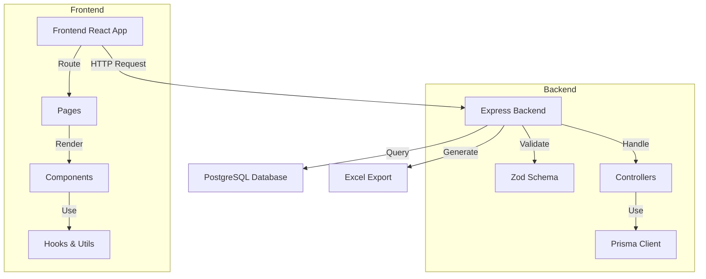

# 🌟 Pranexity

    
    
    
    
    

## 👥 Team Members

    <table>
        <tr>
            <td align="center">
                
                 
                <b>Shivansh Sahu</b>
                 
                🚀 Full Stack Developer
            </td>
            <td align="center">
                
                 
                <b>Parth Sarthi Sharma</b>
                 
                🎨 Frontend Developer
            </td>
        </tr>
    </table>

## 🛠️ Tech Stack

Click to expand

### Frontend
- ⚛️ React with TypeScript
- 🎨 TailwindCSS for styling
- 🔄 Framer Motion for animations
- 📱 Responsive design principles
- 📝 React Hook Form for form handling

### Backend
- 🚀 Node.js & Express
- 🔷 TypeScript
- 🗃️ Prisma ORM
- 🐘 PostgreSQL Database
- 📊 ExcelJS for export functionality

### Development Tools
- 📦 Vite for frontend bundling
- 🔍 ESLint & Prettier
- 🧪 Type safety with TypeScript
- 🔄 Git for version control

## 📁 Project Structure

\`\`\`
Pranexity/
├── src/                      # Frontend source files
│   ├── components/          # Reusable React components
│   ├── pages/              # Page components
│   ├── data/               # Static data files
│   └── assets/            # Images and static assets
│
├── backend/
│   └── contacts/          # Contact form backend service
│       ├── prisma/       # Database schema and migrations
│       ├── src/         # Backend source code
│       └── exports/     # Generated Excel exports
│
├── public/               # Static files
└── package.json         # Project dependencies
\`\`\`

## 🏗️ Architecture

## 🌊 Data Flow

1. **Contact Form Submission**
   - User fills out contact form
   - Client-side validation
   - Form data sent to backend API

2. **Backend Processing**
   - Validate incoming data with Zod
   - Save to PostgreSQL via Prisma
   - Generate Excel export
   - Return success response

3. **Frontend Response**
   - Show success message
   - Reset form
   - Update UI state

## ✨ Features

- 🎨 Modern, responsive design
- 🔐 Form validation
- 📊 Excel export functionality
- 🔄 Real-time form feedback
- 💾 Persistent data storage
- 🌐 Cross-browser compatibility

## 🚀 Getting Started

1. Clone the repository
\`\`\`bash
git clone https://github.com/n3crozma147/Pranexity.git
\`\`\`

2. Install dependencies
\`\`\`bash
# Frontend
npm install

# Backend
cd backend/contacts
npm install
\`\`\`

3. Set up environment variables
\`\`\`bash
# Create .env file in backend/contacts
cp .env.example .env
\`\`\`

4. Start development servers
\`\`\`bash
# Frontend
npm run dev

# Backend
cd backend/contacts
npm run dev
\`\`\`

## 📄 License

This project is licensed under the MIT License - see the [LICENSE](LICENSE) file for details.

